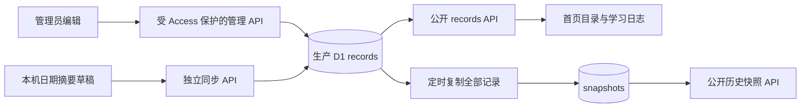
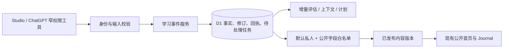

# Wayneo 架构与阶段 0 审计

2026-10-14 C2-I生产增量：用户明确确认四项迁移后，wayne-learning上0002–0005及ledger已执行成功；9私人空表、schema指纹/FK、旧4日志/5快照逐值不变和五个公开HTTP200直接核验。未部署新Worker或登记owner/导入私人，真实接入/备份策略仍未启用。见[迁移结果](database-migration-result.md)，以下历史“新表未在生产”仅适用于此前批次。

2026-10-14 C2-H：生产D1只读确认旧业务表与ledger0001，4日志/5快照，新私人表尚不存在。已备份旧公开应用数据并本地恢复核对；4项增量迁移的schema漂移/前缀/hash预检及SQLite/内存D1保留旧值、9空表、失败回滚接续通过，130/130与类型检查通过。线上迁移待明确授权，未部署。详见[数据库上线准备](database-migration-readiness.md)。

2026-10-14 C2-G最新：加密私人备份/独立删除检查点导出与空目标原子恢复服务已实现；默认恢复owner停用、旧grant撤销、无旧任务，删除过滤与版本推进保持。126/126、非增量类型检查和内存D1的22种回滚注入/旧备份过滤通过。尚无密钥/检查点存储、保留策略、生产备份入口或真实远程接入，见[私人备份](private-backup.md)。以下保留此前历史状态。

2026-10-14 C2-F最新：完整应用隔离构建、生成Worker/workerd实际路由和Chrome SSR/客户端/内存D1闭环已通过；页面保护/缓存、保存纠正历史删除、权限与公开隔离验证通过。117/117、非增量类型检查与三个视口/键盘/减少动画通过。真实Access/ChatGPT/手机与线上部署仍未验证。见[完整Worker验证](studio-worker-verification.md)，以下保留历史状态。

2026-10-14 C2-E最新增量：受保护Studio页面源码、完整回执/DTO校验与单次context、同步提交锁和过期响应保护已交付；117/117、非增量类型检查和独立Chrome合成HTTP/SQLite链路通过。逐视口320/390/1280、真实Tab焦点与Escape/返回焦点、减少动画检查通过。完整Vinext Worker构建/派发、真实Access/ChatGPT/手机和部署仍未验证，见[Studio本地验证](studio-local-verification.md)。下文保留此前历史状态。

2026-10-14最新本地增量：C2-D已实现owner-only删除、CAS/幂等回执、无正文防复活标记/键、物理清理与隔离恢复过滤；读取/context/history屏蔽标记下的旧正文。112/112测试、非增量类型检查与内存D1验证通过；未部署、未挂载Studio，真实私人导入仍受检查点独立存储/保留策略及完整恢复门槛限制。详见[删除与恢复](private-deletion.md)。以下阶段0/C2-C审计保留历史口径。

更新：2026-10-13，Asia/Shanghai。审计基线：`main` / `a8551830de8b660d65be9a1b9d09b4bf642cd2b3`。

本文记录当前事实与推荐方案；任务进度、检查结果和两边开发的文件归属见 [实施计划](implementation-plan.md)。阶段 0 仅修改文档，未修改业务代码、配置或线上数据，未提交、推送或启用任务。私人学习背景不写入这些文档。

后续状态：2026-10-13 C1完成本地身份/权限基础，C2-A完成原子保存，C2-B完成当前回读/上下文/受保护HTTP，C2-C完成事件纠正/CAS、原回执重放与受保护分页历史。全套101项测试、非增量类型检查及仅内存Miniflare/workerd D1绑定检查通过；HTTP handler在Node调用，框架路由派发/构建、真实Access与浏览器完整闭环未验收。删除仅有准备文档，物理删除/防复活/过滤恢复未实现，真实私人导入仍禁止。Gemini G3交接v3及历史产物保留，其完整回执、键盘焦点、减少动画和逐视口断言存在证据缺口。Codex独立负责前后端，不调用其他模型/子代理。没有生产部署或真实身份登记。本章线上审计仍以阶段0为时间基线，不据本地测试更新线上能力。

## 1. 证据口径

- **本地已核验**：直接读到的代码、配置，以及本轮实际执行的检查。
- **后台已核验**：本轮只读 Cloudflare/GitHub API 返回的配置、状态。
- **线上只读已核验**：实际 HTTP GET 的状态和必要元数据，不等于登录、写入或手机端流程通过。
- **推断/推荐**：根据上述证据提出的设计，尚未实现。
- **未核验**：账号、客户端、历史数据或运行结果未实际验证。历史文档的成功记录只代表当时记录，不自动延伸到本轮。

## 2. 真实现状

项目根目录是 `D:\codex_dev\web\wayne-site-migration\wayne-site`，外层 `web` 不是 Git 仓库。未发现项目级或祖先目录的 AGENTS.md/CLAUDE.md/GEMINI.md；已有 `.ccg/spec/frontend/index.md`，要求复用 `--editorial-*` 变量、保持阅读字号、中文换行和移动端对齐。

| 项目 | 本轮依据与结论 |
| --- | --- |
| 前端 | TypeScript、React 19.2.6、Next.js 16.3.4 的 App Router 文件结构；实际 dev/build 用 Vite 8.0.13 + Vinext 1.0.0-beta.5，不是直接运行 `next build`。见 `package.json`、`vite.config.ts`。 |
| 包管理/运行时 | 指定 pnpm 11.25.0，锁文件 `pnpm-lock.yaml`；`.node-version` 和 CI 使用 Node 24。当前可执行 Node 为 24.15.0。 |
| 后端/托管 | `worker/index.ts` 交给 Vinext fetch handler；Wrangler 静态资源绑定 + Workers。Cloudflare 后台确认 `wayne-site` 存在，绑定 D1 和 ASSETS。当前站点的主域名指向 Worker，不需要重新建立 Pages 或 Worker。 |
| 数据 | `lib/database.ts` 在运行时读取 D1；源码迁移定义 `records`、`snapshots`。后台确认生产库 `wayne-learning`；本轮未查询线上 sqlite_master，不据此宣称实际表结构已逐项核验。 |
| 认证 | Access 应用保护两个域名的 `/admin`、`/api/admin/*`；后台策略只允许配置的所有者。`lib/access.ts` 验证 JWT 签名、Issuer、Audience、时间和邮箱，不信任转发邮箱。当前 IdP 是 `onetimepin`，Google 登录未配置。 |
| 机器同步 | `/api/sync/records` 接受独立 Bearer 凭证，Worker Secret 保存摘要；后台只核验 Secret 名称/类型，未读取其值。支持日期摘要的版本保护、相同内容重试和客户端回读。不是新事件契约。 |
| Git | 当前 `main` 与本地 `origin/main` 同提交；GitHub 分支 API 再次确认同 SHA。`design/frontend` 本地比分支跟踪引用多一个提交，保留不合并。初始无 tracked 文件修改，有 24 张未跟踪截图，全部保留。 |
| 仓库/检查 | GitHub 仓库为 public，默认分支 main；当前分支 API 返回 `protected:false`。保护详情匿名读取返回 401，Environment 审批者与 Secret 权限未核验。 |

现有入口：`/`、`/learning`、`/projects`、`/admin`。Logo 用已有 `public/wayneo-logo-clean.png`；首页、字体、摄影、刊物排版和主题保持现状。`app/globals.css`、`app/publication.css`、`app/journal-reading.css` 已含焦点、safe-area、长文本与减少动画规则；本轮未重新做视觉、触屏或键盘端到端测试。

### 内容流



- 首页 `app/personal-home.tsx:44` 和日志 `app/journal.tsx:20` 通过 fetch 读 `/api/records`；页面每 60 秒刷新，并在恢复可见/焦点时刷新。数据更新不依赖代码重新部署，但实际浏览器刷新延迟本轮未通过写入测试测量。
- 公开 API 返回 `Cache-Control: no-store`；本轮首页、日志、项目页均 HTTP 200，公开接口返回 4 条日期记录、4 份快照。只核对数量和字段，没有把正文另存进审计文档。
- 首页其他介绍、联系方式、影像和 `/projects` 方向目录主要来自 TSX/静态资源，修改仍需构建部署。项目页有“蓝图/整理中”标注，不能当作已完成作品证据。
- `data/` 含历史导出、同步草稿、来源检查点和本机状态，是被忽略的辅助文件。当前网页主读取源已是线上 D1；这些文件不是第二个正式主库。
- `scripts/sync-record.mjs` 会读取本机凭证、写状态并 POST 到正式域名；本轮未运行。`export-data.mjs` 只导出现有公开接口，不能直接充当未来私人数据库备份工具。

### 部署流

1. main push → `.github/workflows/deploy.yml` 安装固定依赖 → test/typecheck → `pnpm deploy`。
2. `pnpm deploy` 内部 build → **远程数据库迁移** → 部署 `dist/server/wrangler.json`。迁移成功、代码部署失败可能造成“新结构 + 旧代码”，因此未来迁移必须兼容旧版本。
3. 同提交的独立 Check 工作流也运行 test/typecheck/build；Deploy 自己执行检查，不是依赖 Check job 完成。最新 [Deploy website](https://github.com/wayneren906-cmd/Wayne-site/actions/runs/38390181618) 和 [Check](https://github.com/wayneren906-cmd/Wayne-site/actions/runs/38390181588) 均成功；部署 job 的检查及构建/迁移/发布步骤均成功。
4. Cloudflare Workers Builds 后台也有 main 自动触发：构建命令含 test/typecheck/build，部署命令含远程迁移；`auto_build_enabled=true`，本轮读取到的构建列表为空。配置存在不等于这条发布路径已实际跑通，也不证明历史账户限制仍然存在。
5. Cloudflare 最新部署版本为 `f5001468-59ee-4f29-92ed-930a866eaecf`，100% 流量，时间为 2026-10-13 19:26:50 北京时间。与最新 GitHub 工作流同日成功相符；未读取日志证明版本 ID 与 SHA 的严格对应关系。

**重要：`study-test.wayneo.dev` 与 `wayneo.dev` 均绑定同一个 production Worker，只有同一个 DB 绑定，后台 previews_enabled=false。测试域名是生产别名，不是隔离预览。**

### 已有自动化

- Cloudflare 后台确认两条既有 Cron：UTC `0 15 * * *`、`55 21 * * *`，对应北京时间 23:00、次日 05:55。源码 scheduled handler 仅复制已有 records，不读取聊天，也不生成新学习。
- 本机 `wayneo-dev` 的 automation.toml 状态仍为 ACTIVE，名称“每天同步学习记录到 wayneo.dev”，每日 06:00；提示依赖本机文件和聊天检索，也引用旧复盘来源。这与已停用的教学计划/复盘是不同任务，不能混为一项。
- 本轮没有创建、恢复、修改、暂停或运行这些任务；ACTIVE/有 Cron 只证明配置，不证明首轮成功、来源完整或无人确认可执行。旧每日计划、每日/周复盘及其他独立任务均不恢复、不调整。现有同步任务与未来规则的冲突需要单独决定。

## 3. 能力清单

下表保留阶段0的线上审计口径；其后C1/C2-A/C2-B/C2-C已在本地实现稳定身份/grant、私人事件/回执/outbox、原子保存/纠正及受保护HTTP保存/回读/上下文/历史，但未接真实身份、挂载Studio页面或部署。表中“未实现”是历史线上基线，最新本地进度以开头与实施计划为准。

| 状态 | 能力 | 限制 |
| --- | --- | --- |
| 已实现，部分线上只读核验 | 现有网站、运行时日志读取、月份/日期/全文筛选、主题、公开快照 | HTTP 读取通过；交互和手机真实体验未重测。 |
| 已实现，单元/集成测试核验 | Access 签名验证、同源校验、日期摘要版本保护、相同内容重试、06:00 学习日、导入转义 | 17 项测试有签名合成 JWT、内存 SQLite 和 mock；不代表 Google/平台集成端到端通过。 |
| 部分实现 | 同步、历史修订、备份、失败显示、可访问性、作品展示 | 本机同步文件与日期摘要；无事件级来源/回执/历史修订；快照不等于异地备份；作品主要是方向描述。 |
| 未实现 | 私人 Studio、稳定用户 ID、Google 登录、细粒度可撤销工具权限、事件/成果/证据、多维评估、目标大纲/唯一计划、任务 outbox、公开白名单 | 需要增量建设，不能由现有日期摘要推导“已掌握”。 |
| 未核验 | 本人本轮登录写入、Google/OAuth/撤销、真实 ChatGPT 手机接入、平台定时调用、生产限流/缓存规则、恢复演练、成本/Secret权限、合并规则详情 | 账号或真实测试门槛，按实施计划推进。 |

## 4. 优先问题

| 优先级 | 依据 | 影响与处理方向 |
| --- | --- | --- |
| P0：私人/公开尚未分离 | `app/api/records/route.ts:6`、`app/api/snapshots/route.ts:8`、`lib/database.ts:3` | 全部日期记录和快照原文都匿名可读。现有记录是公开日志，不能仅凭这个认定发生私人泄露；但任何未来私人事件都不得写入这条公开读取链。先建私人服务与公开投影，快照也要同样隔离。 |
| P0：预览共用生产 | `wrangler.jsonc` routes/DB、后台域名绑定 | 在“测试站”写入等于修改生产。先本地隔离；远程预览 Worker/DB 创建需另行授权。 |
| P1：日期摘要不能承载学习事实 | `migrations/0001_initial.sql:1` | 日期为主键、items 为 JSON，一天更新只能覆盖一个摘要；无 occurred_at、来源 ID、证据与事件修订。新增事件表，保留按日聚合展示。 |
| P1：快照时间被当作内容更新 | `app/api/records/route.ts:5`、`app/journal.tsx:51` | lastSync 是 snapshots.updated_at；无新学习也会变化。分别显示内容版本/更新时间、快照保存时间、已观察事件时间。 |
| P1：practice 语义冲突 | `docs/learning-sync.md` 与 `app/journal.tsx:52` | 同步文档定义实际练习，界面标为“后续练习”，历史可能混有计划。旧字段先标为中性“练习与补充”，迁移不能自动当已完成成果。 |
| P1：生产发布/迁移风险 | `package.json:15`、两个发布配置、main protected=false | 双触发可能重复发布/迁移；GitHub concurrency 只约束自身工作流。建议保留已验证 GitHub 路径，另行批准后整理 CF 触发；加强合并检查与迁移发布门槛，不在本轮改配置。 |
| P1：授权不足以支撑 Studio | `lib/access.ts:43`、`lib/sync.ts` | 所有者按邮箱识别；机器凭证可读写全部旧摘要，无独立 grant/scope。保留 JWT 验证，新增稳定身份映射和撤销；不把普通登录变管理员。 |
| P2：可靠性/规模空缺 | `lib/database.ts`、`lib/sync.ts`、scripts | 多处读取全部日期记录；无持久化分析任务、租约、有限重试、来源覆盖版本、私人导出删除。按真实查询分页和索引，先保存事实，后台处理失败可恢复。 |

源码使用参数化 SQL、React 文本输出、同源校验；同步接口有 64 KiB 流式大小限制。管理 POST 尚无同等明确大小限制，源码未见应用限流。后台是否配置额外规则未核验。`.dev.vars`、data 和环境文件被忽略，未见其在当前 tracked 清单；未做全 Git 历史密钥审计，不宣称历史一定安全，亦不重写历史。

## 5. 架构收敛与取舍

**推荐：原有 Vinext/Workers/D1 上扩展一个按职责分模块的单体。** 不升级依赖、不换框架，不再建设另一套 CMS、用户系统或主库。

| 方案 | 收益 | 代价/回退 | 结论 |
| --- | --- | --- | --- |
| 扩展现有 Worker + D1 | 复用部署、鉴权、视觉与运行时读取；只有一个权威写入位置 | beta 框架需固定版本与回归测试；增量表/接口可关闭，公开旧视图暂留 | 推荐。 |
| 继续只强化日期摘要 | 短期更省代码 | 无法可靠保留同日独立事件、证据、修订或私人边界 | 只作为旧公开内容兼容层。 |
| 独立后端/换框架 | 可以换成熟实现 | 多一套部署、认证、迁移与前端适配，无已证实必要性 | 暂缓；真实兼容阻塞时再评估。 |

职责边界：认证与授权 → 接入适配 → 学习事实/成果 → 评估与规划 → 上下文 → 公开内容 → 任务与运行状态。它们是同仓库模块，不是微服务。REST、MCP、未来 Actions 都调用同一服务，不各自存数据或维护计划。



- D1 为正式主库，本地库只供测试/开发。附件实际需要时才加 R2；不先加向量库、图库、n8n、Queues、复杂 Agent 或第二套模型每日重复总结。
- 初期使用数据库任务记录，提交时持久化 outbox；本地显式处理验证恢复。生产执行器/调度在授权和需求明确后才选，不能只写任务行就宣称后台会自动执行。
- 首次允许自动公开前确认范围。普通私人记录可直接保存，公开候选自动检查白名单；不确定内容只留私人区。公开快照必须由已发布投影生成，不能复制私人库。
- 私人响应 `no-store`，不走共享缓存。公开内容可缓存有效版本；撤回时处理当前版本、历史公开快照、缓存和搜索索引。服务故障保留最近有效公开版本并标出实际更新时间；私人旧缓存不用于匿名降级。
- Google 优先评估现有 Access 接入成熟 Google OIDC，而非新建账户系统；验证 issuer/sub 等稳定身份的实际可获得性。MCP 所需 OAuth 资源授权与浏览器 Access 登录不是同一件事，不把登录 JWT直接转发给另一服务，也不自行手写完整 OAuth 协议。

## 6. 核心关系与最小契约（部分本地实现）

关系：用户拥有目标/偏好、事件、成果和计划；事件通过关联表连接多个知识点、成果和目标，计划关联可空。评估引用具体事件/成果版本，保存支持与反证；大纲通过版本成员关联稳定知识点。当前计划只允许一个有效指针，修订保留依据。公开内容、上下文、日报周报和快照均是派生结果。

第一批物理表只落实可靠事件写入需要的集合：`users`、`integration_grants`、`learning_events`、`event_revisions`、`ingest_receipts`、`processing_jobs`、`learning_state`；旧 records/snapshots 暂留。目标、知识关系、成果/题目/答案、评估、现实安排、计划、公开版本按阶段加入，不先建一套空表。

C1建上述集合中的users、integration_grants、learning_events、event_revisions、learning_state五张空表；C2-A通过`0003_ingest_outbox.sql`补充ingest_receipts和processing_jobs，并原子保存事件/回执/版本/任务。C2-C通过`0004_correction_authority.sql`将create/correct回执授权分开；纠正CAS服务已本地实现。迁移不填真实用户、不复制旧记录，事实表只允许private；发生时间未知时保留NULL。重复执行只核验同一迁移在干净测试结构上的幂等，不证明能修复既有结构漂移；没有应用到共享本地库或生产。

本地身份接口：`lib/learning/auth.ts`的verifyLearningOwner先调用既有签名验证，再用issuer+sub查找预登记、active且role=owner的内部user_id；无登记即拒绝，不自动注册。verifyLearningGrant验证SHA-256摘要、owner、scope白名单、到期与撤销；requireLearningPermission同时检查owner与scope。principal不可变且带模块内部标记，JSON请求或序列化副本不能变成身份。以后每次请求重新认证，不缓存principal或把验证options从客户端传入。

本轮仅按[Access应用令牌文档](https://developers.cloudflare.com/cloudflare-one/access-controls/applications/http-apps/authorization-cookie/application-token/)确认用户sub的契约；它按账户/邮箱标识Access用户，服务令牌sub可为空，不等同于Google OIDC sub。没有读取真实JWT或注册真实身份；现有管理员仍按原实现工作，新增模块保留原邮箱授权作为附加门槛。

`lib/learning/contracts.ts`提供共享v1类型；C2-C仅增补LearningCorrectionInput和LearningEventHistoryDTO，已有契约不变。`event-validation.ts`落实strict输入与规范化；`events.ts`与`corrections.ts`落实原子幂等保存/纠正，`write-support.ts`共享权限、hash、回执与事务内守卫。来源仅studio与studio_supplement，未知证据默认unknown；来源字段不证明经过外部验证。知识/计划ID当前仅保存引用，不表示关联存在或计划执行。HTTP保存/纠正/当前回读/上下文/历史已本地实现；隐私删除、后台执行、公开投影和真实集成未实现。

### C2-B本地读取与HTTP边界

- `reads.ts`在同一主库D1 batch中读取当前owner/grant授权、版本、元数据和事件；不使用复制会话，不把分别读取的版本拼成一个上下文。复查撤销/到期、active owner与scope集合的白名单/类型/去重。
- 当前事件按owner+event_id取current_revision，SQL只投影允许字段并校验DTO；不返回owner、actor、原始payload、幂等键或测试字段。缺失与他人事件都不可见；缺失/损坏当前修订则脱敏失败，不回退成旧事实。
- context用途限制teaching=20、planning=10、review=40、portfolio=10条，按received_at与event_id确定排序，UTF8响应至多64KiB；裁剪整个事件并同步来源与证据引用。latest_observed_event_at来自所有已知发生时间的最大值，不是接收/生成时间。数据未评估、聊天未接入、大纲/计划缺失及遗漏事件如实标记；processed_version=0不代表后台执行完成。
- `http.ts`和三个`app/api/studio`薄路由只接受签名Access断言+预登记owner，浏览器入口不接受Bearer grant回退。POST要求同源、JSON、流式64KiB及有效UTF8；首存201、重放200、冲突409、无身份401、无权限403、不可见事件404、过大413、异常503。私人响应no-store，不添加跨源读取许可。
- 现有Access仅保护admin，不据此宣称studio路径受边缘保护。未来挂载/部署须另验Access覆盖、真实owner登记和框架派发；本批没有改Access/Secret/资源配置。机器grant只可调用已授权服务，MCP/OAuth HTTP授权另作适配。

### C2-C本地纠正与历史边界

- `correctLearningEvent`接收strict v1纠正信封：expected_revision、非空reason、完整替换event。保留event_id/source/kind/原received_at/private；不允许把历史摘要改成独立练习。events:correct不蕴含events:write或events:read。
- owner/event/revision/source/kind条件CAS、data_version递增、新修订、回执和pending任务在同一D1 batch提交；每个必要写入均有事务内changes()守卫。规范化hash包含目标/CAS/原因/替换事实，不含transport key。旧create/correct回执在后续修订后仍原样重放，当前读取另取最新版本。
- 历史按owner、event和before_revision分页，最多10条+1条lookahead、64KiB UTF8；整修订裁剪与续页游标一致。时间/证据/内容取对应修订payload，保留原事件接收时间。授权、状态、当前有效正文、历史同一个主库batch，游标不能绕过损坏当前正文的拒绝。
- `PATCH /api/studio/events/{event_id}`沿用签名owner/同源JSON/受限UTF8/no-store；新纠正201、重放200、旧CAS409。`GET /api/studio/events/{event_id}/revisions?before_revision=2`仅接受唯一canonical安全正整数；缺失/他人事件一致404。无Bearer fallback或新增CORS。
- 合成SQLite与内存D1核验全部五个纠正写入ABORT/IGNORE整体回滚、同/异key并发、丢失响应、7类grant竞态/重放拒绝、owner禁用/隔离、历史分页及损坏head游标拒绝。未验证框架派发、浏览器或生产。
- 物理删除尚未实现；外键清理、无正文重放拒绝、备份早于删除时的存活删除记录与单调版本门槛详见[删除准备](../.ccg/tasks/archive/2026-10/wayneo-c2c-corrections/deletion-readiness.md)。真实私人导入仍禁止。

| 对象 | 最少关键字段/约束 |
| --- | --- |
| 用户/授权 | 内部 user_id；经验证的 issuer+subject 唯一映射；服务 grant 的摘要、scope、到期/撤销时间。权限来自服务端，不接收 payload 的 owner/role 决定权限。 |
| 事件 | event_id、owner_id、source_type/source_record_id、kind、occurred_at、time_precision、received_at、study_day、日期覆盖原因、必要内容/引用、evidence_status、assistance、execution_mode、visibility、revision。 |
| 修订 | event_id+revision 唯一，supersedes_revision、操作者、原因、修改时间、该版本内容。修正可追溯；隐私删除另有清理流程，不能以审计为由永久保留被要求删除的原文。 |
| 回执 | owner+grant+operation+idempotency_key 唯一，规范化载荷 hash、event_id/revision、保存时 data_version、received_at；请求重放返回原回执。 |
| 状态/任务 | owner 的 data_version；job 关联事件版本、处理种类/规则版本，唯一任务键；status、attempts、next_attempt_at、lease_until、脱敏失败原因。上下文可即时计算，不必先建快照表。 |

常用查询字段独立列，扩展 details 为经过版本化校验的 JSON。初期索引围绕 owner+study_day、来源记录标识、幂等键、待处理状态/下次尝试；不对全部字段建索引。必要知识前置检查循环；推荐关系不强制解锁。

事件契约 v1 的合成示例（不是用户学情；任何未来生产测试先有独立授权）：

```json
{
  "schema_version": 1,
  "idempotency_key": "test-run-01:event-01",
  "source": {"type": "studio", "record_id": "synthetic-event-01"},
  "kind": "learning_activity",
  "occurred_at": "2026-10-13T05:59:59+08:00",
  "time_precision": "exact",
  "study_day_override": null,
  "content": {"summary": "合成测试：解释示例概念"},
  "evidence_status": "self_reported",
  "assistance": "unknown",
  "execution_mode": "unknown",
  "knowledge_ids": [],
  "plan_id": null,
  "test_run_id": "synthetic-stage1-01"
}
```

- 服务端产生 event_id/received_at，身份决定 owner；默认 private，普通接入无发布权限。新契约拒绝未知字段、非法时间/枚举、超长内容和无原因的日期覆盖。
- 精确时间按 Asia/Shanghai 当地时间减 6 小时取日期；上例属于 2026-10-12。C2-A接收带偏移的时间并规范化保存为UTC；v1没有另存原始偏移字段。仅知日期时不伪造午夜；时间未知则occurred_at/study_day可空，不能用接收时间代替发生时间。
- 修正携带 expected_revision、原因和新内容。来源记录 ID/幂等键用于确定身份，不用文本相似度删除事件；同日两次练习使用不同来源 ID，分别保存。
- `POST /api/studio/events`：首次 201；相同键/相同规范化载荷 200 重放；相同键/不同载荷 409 `IDEMPOTENCY_CONFLICT`；陈旧修订 409 `REVISION_CONFLICT`；无效输入 400，缺少身份/权限 401/403，体积超限 413，限流 429。错误不能返回别人的正文。
- 回执包含 receipt_id、event_id、revision、received_at、study_day、data_version、`saved=true`、`processing_status=pending`、replayed。**保存成功不等于已评估/已发布**；读取 `/api/studio/events/{event_id}` 核对当前版本，旧回执不假装是当前最新内容。
- `GET /api/studio/context?purpose=teaching` 返回裁剪内容、generated_at、latest_observed_event_at、data_version、assessment_processed_version、outline/policy_version、covered_sources、unknown_ranges、必要 evidence_refs。purpose 使用白名单，限制响应大小；空队列和新快照都不意味着来源完整或有新学习。
- MCP 适配先只暴露 `get_learning_context`、`get_event`、`submit_learning_event`；评估、意愿/修正以后按 scope 加入，不开放任意 SQL、发布或后台管理。

### 写入与恢复

同一次数据库原子操作保存事件、修订、回执、数据版本和 outbox。D1 的 [batch](https://developers.cloudflare.com/d1/worker-api/d1-database/) 支持序列失败时整体回滚；实现不能直接照搬 Node SQLite 的交互事务写法。特别注意：条件 UPDATE 影响零行不算 SQL 错误，必须让后续写入也受同一版本条件约束，或通过明确约束失败整体回滚，并测试无孤立回执/任务。

C2-A实际在每个必要写入后追加事务内`changes()=1`SQL守卫，零行时强制SQL失败，不能等batch提交后再看meta。回执插入trigger复查owner、grant归属、到期/撤销及scope白名单/类型/去重，并校验当前data_version；任务用复合外键绑定回执/owner/event/revision/data_version。幂等键按owner+credential+operation隔离，同内容重放原回执，不修改状态；失败时只有复查当前权限并读到相同hash的已提交回执才恢复成功。所有数据库异常路径返回脱敏SERVICE_UNAVAILABLE，冲突/授权拒绝保留明确错误。已在真实内存D1测试并发/回滚/恢复；这不包含HTTP状态映射、生产迁移或任务自动处理。

任务使用有限重试、退避、超时与租约；同事件版本/规则版本结果可复用。评估/计划写入检查依据版本，旧结果不能覆盖新修订；模型失败仍保留事实和旧有效计划。用户不必重新描述历史，重试从保存的输入/结果继续。

旧 records 导入为 `historical_summary`，保留实际已知日期、来源与导入批次，不拆造原答题、独立编程或运行证据。旧 practice 不自动迁成已完成练习。迁移先合成演练，再备份、核对、短暂冻结旧写入、切换；同类数据只有一个权威入口。新旧表按兼容窗口保留，代码回退和数据恢复分别验证。

在接收真实私人数据前完成删除路径：清理事件/修订正文、任务输入/结果、上下文与相关派生副本；保留必要的无正文删除状态，防止任务重放或旧备份恢复使内容复活。附件与备份按明确保留策略处理，不能只在当前事件上打隐藏标记。公开撤回和私人删除是两个不同操作。

## 7. ChatGPT 接入可行性

查证日期：2026-10-13。优先试 **窄权限远程 MCP 插件 + OAuth**，备选 Custom GPT Actions；只读取接入工具明确提供的当前上下文/事件，不假设能导出全部历史聊天。暂不增加网站聊天入口或网站模型 API，也不以手工日更文件作正式方案。

| 入口 | 官方能力/本轮结果 | 确认、范围与限制 |
| --- | --- | --- |
| ChatGPT 网页自定义 MCP | 官方支持 read/write、SSE/Streamable HTTP 和 OAuth；Wayneo 端点/授权未实现、未实测 | 写操作默认有确认；权限偏好与工作区策略影响体验。连接工具不自动获得所有聊天。 |
| 手机 Chat/Work 插件 | 当前官方文档说明账号可用插件支持网页、桌面和手机；Desktop only 例外 | Wayneo 自定义插件在用户常用手机/账户的可用性、确认频率、重连均未测。不能沿用“网页通过即手机通过”。 |
| Custom GPT Actions | 官方支持 REST/OpenAPI + OAuth 或 API key | 是 Custom GPT 内的入口，不能默认替代日常聊天。POST 缺少 consequential 标记时默认需要确认；真实影响决定标记，不通过误标绕过审批。客户端和撤销待测试。 |
| ChatGPT Work 定时任务 | 当前文档说明可使用该聊天可用的插件/工具，云端与本机项目任务不同 | Wayneo 授权、工具可用性、确认和来源覆盖仍未测；本轮不建任务。固定时刻不保证上游摘要已产生。 |
| 既有 Codex 本机同步 | API 与脚本存在，旧文档记录过手动成功；本机任务 ACTIVE | 依赖电脑、文件、聊天检索；本轮未执行同步/核实全部来源。不选为未来正式双向接入核心。 |

官方依据：[自定义 MCP](https://developers.openai.com/api/docs/guides/custom-mcp-server)、[插件支持入口](https://learn.chatgpt.com/docs/plugins)、[OAuth 认证](https://developers.openai.com/plugins/build/auth)、[确认偏好变化](https://developers.openai.com/plugins/changelog)、[GPT Actions](https://developers.openai.com/api/docs/actions/introduction)、[Actions 生产约束](https://developers.openai.com/api/docs/actions/production)、[Actions 认证](https://developers.openai.com/api/docs/actions/authentication)、[定时任务](https://learn.chatgpt.com/docs/automations)。这些说明技术可能性，不能替代该账号测试。传统网页登录与机器授权分别验证；撤销后 API 必须拒绝现有访问令牌/授权且不泄露数据。

真实接入验收：独立预览、合成 test_run → 从实际教学入口读取最小上下文 → 提交一个事件 → 得到持久化回执 → 再读核对 → 用相同键重试 → 同键改载荷冲突 → 撤销授权后明确失败。分别记录网页、实际手机客户端、是否确认、操作次数、测试日期、数据覆盖范围和令牌失效表现。模拟 REST/MCP 通过只记为接口测试；实际接入受限时继续独立数据/界面任务，不宣称全自动，不迁移用户入口或默认开通付费能力。

## 8. 后续学习机制与运行边界

- 概念解释、代码分析、独立编写、编译运行、调试、迁移应用、延迟保持分别观察；未知保持未知。保存提示、答案查看、运行环境、题目/答案版本、同题重试与证据来源。AI 代码测试通过不能升级用户独立能力。
- 成果可关联事件和复盘，提交/验收/掌握分别建模；总结不重复算练习。讲解或判题纠正能使关联评估失效并重算。
- 目标意愿、大纲和知识档案分开；明确决定可生效，临时兴趣不改主线。计划按期限、必要前置、现实条件和预算做可解释排序，GPT只设计具体教学；已开始任务尽量稳定，短期输入合并，未完成任务可缩小/取消，不滚成无限补课。
- 新增硬件、项目或职业认知不自动删减既有系统语法学习；路线调整以有效用户决定和实际证据为依据，不以听过名词当掌握。
- 先主动提取、逐步减少提示、简单可配置复习和自然延迟验证。学校实践可复用证据。调度接口可替换，FSRS 只在明确回忆结果有收益时评估，不设虚构样本门槛，也不用它评分工程能力。不做综合百分比或学习风格标签。
- 内容模块以真实素材决定，优先 Now/Projects/Journal，再按需 Roadmap/Notes/搜索。技术笔记核验后公开；不把代码提交/聊天条数当能力。
- 成本先统计 Worker/D1/存储和未来模型用量，未经授权不引入新模型费用。预算数值由用户以后设置，超限停止非必要分析，保留事实和旧计划，不承诺永久免费。
- 备份覆盖私人数据、附件/派生数据，恢复须验证内容、数量、关联、版本和重新处理能力。隐私删除覆盖修订原文、附件、派生内容和可控备份保留策略；Time Travel 是灾难恢复，不是单条记录撤销。

Cloudflare 参考：[本地 D1](https://developers.cloudflare.com/d1/best-practices/local-development/)、[版本迁移](https://developers.cloudflare.com/d1/reference/migrations/)、[Cron UTC 语义](https://developers.cloudflare.com/workers/configuration/cron-triggers/)、[预览资源隔离](https://developers.cloudflare.com/workers/previews/resources/)。新预览能力不直接套到当前固定 Wrangler 版本，实施时先核对兼容；初期可用显式独立 preview 环境，默认不继承生产域名、DB、Secret 或 Cron。
